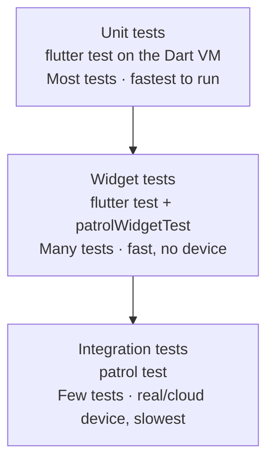
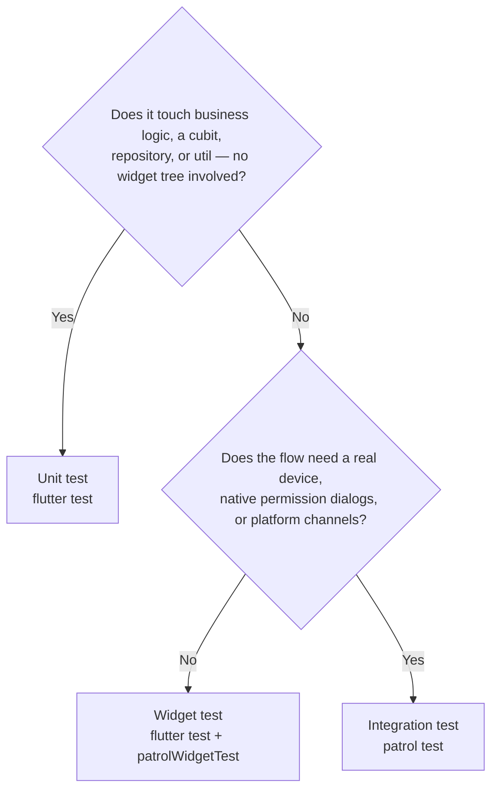
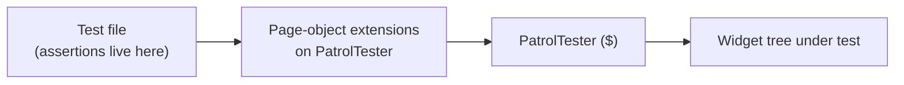
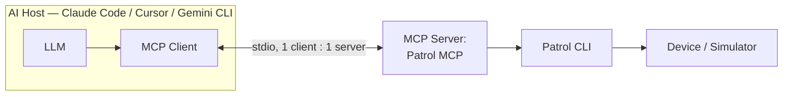
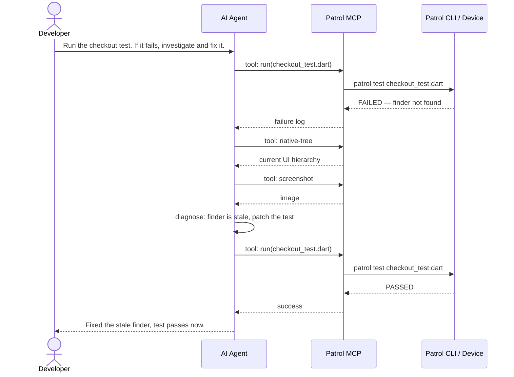

# The Ultimate Guide to Patrol: Elevating Flutter UI Testing with AI & MCP

[](LICENSE)


*A guide to scaling UI testing in production Flutter apps, from the three-tier testing
strategy through to AI-driven test automation using the Patrol MCP
(Model Context Protocol) server.*

> **Author's Note**: This content includes Esra Kadah's own development and hobby
> knowledge for community work and some experiences with current employment at
> Antigua Mobile, drafted with Gemini 3.1 Pro Preview, Fable, Opus, and Sonnet 5.
> All employer, client, and project names have been abstracted; the example app is
> referred to as `AppName` throughout. Facts about Patrol and MCP were independently
> verified against primary sources as of 2026-08 (see [Further Reading](#further-reading)).

## Choose your path

| | Read this if... | Start at |
|---|---|---|
| 🟢 **Beginner** | You know `flutter test` but haven't structured a testing strategy | [The Testing Strategy](#the-testing-strategy) |
| 🟡 **Intermediate** | You're ready to adopt Patrol for widget and integration tests | [Patrol Implementation Guide](#patrol-implementation-guide) |
| 🔴 **Advanced** | You want an AI agent to write, run, and fix your tests | [Enter Patrol MCP](#enter-patrol-mcp-ai-driven-testing) |

New to some of the vocabulary already? Check the [Glossary](#glossary) first.

## Table of contents

- [The Testing Strategy](#the-testing-strategy)
- [Patrol Implementation Guide](#patrol-implementation-guide)
- [Enter Patrol MCP: AI-Driven Testing](#enter-patrol-mcp-ai-driven-testing)
- [Glossary](#glossary)
- [Further Reading](#further-reading)

---

## The Testing Strategy

🟢 *Beginner-friendly. Assumes you've written at least one `flutter test`.*

Before writing a single test, decide *what kind* of test covers *what kind* of code.
Without that map, teams over-test trivia and under-test the flows that actually break.

### The three tiers of testing

| Tier | Tool | Runs on | Dependencies | Covers | Volume |
|---|---|---|---|---|---|
| **Unit** | `flutter test` | Dart VM | fakes / mocks | business logic, cubits, repositories, mappers, utils | most |
| **Widget** | `flutter test` (`patrolWidgetTest`) | Dart VM, no device | faked backend, mocked plugins | screens, components, user interactions, navigation | many |
| **Integration** | `patrol test` | real device / cloud device farm | real backend (staging), real API, native dialogs | critical end-to-end journeys, native permissions, offline | few |



A subtlety worth internalizing: **most "widget tests" run without a device.**
Patrol's widget-test API (`patrolWidgetTest`) executes under `flutter test` in the
Dart VM, giving you Patrol's ergonomic finders and a real widget tree at unit-test
speed. Only the integration tier (`patrol test`) needs an actual device — that's why
the middle tier can be large and fast.

> **In practice**: Tier 1 + Tier 2 live under `test/` and run in CI on every PR via
> `flutter test` (sharded). Tier 3 lives under `integration_test/`, runs via
> `patrol test`, is Android-only in most teams' practice, and runs on a cloud device
> farm post-merge to the staging branch.

### Which tier does my test need?



### What NOT to test

Testing has a cost. Spend it where a test would actually catch a regression.

- **Thin wrapper services** — a class that only forwards a call to analytics,
  logging, or a performance API has no logic to protect.
- **Framework behavior** — you don't need to test that `setState` rebuilds or that
  `go_router` navigates.
- **Generated code** — Freezed / `json_serializable` output is the generator's
  responsibility.

### The regression rule

The most valuable single testing policy: **every bug fix ships with a test that
would have caught the original bug.** This converts each incident into a permanent
guardrail and is the fastest way to raise real (not measured) coverage over time.

---

## Patrol Implementation Guide

🟡 *Intermediate. Assumes you've decided you need widget and/or integration tests.*

[Patrol](https://patrol.leancode.co/) does two distinct jobs. Conflating them is the
number-one source of confusion.

### Two modes, one package

| Mode | API | Command | Device? | What it's for |
|---|---|---|---|---|
| **Widget test** | `patrolWidgetTest` · `PatrolTester` (`$`) | `flutter test` | No (Dart VM) | Fast component/flow tests with Patrol's finders |
| **Integration test** | `patrolTest` · `PatrolIntegrationTester` (`$`) | `patrol test` | Yes (real/cloud device) | End-to-end journeys, native permission dialogs, network toggles |

### Version pinning

**`patrol_cli` (the command-line tool) and `patrol` (the pub dependency) are
separately versioned artifacts.** Pin both, intentionally, and pin the CLI version in
CI so local runs match. Current stable versions, verified on pub.dev:

```yaml
# pubspec.yaml (dev_dependencies)
dev_dependencies:
  patrol: ^4.8.0
  patrol_finders: ^3.6.0
```

```bash
# CI: pin patrol_cli to match, e.g. via `dart pub global activate patrol_cli 4.6.1`
```

When upgrading, bump both together and re-run the integration suite. Patrol 4.0
added Flutter Web support alongside Android/iOS — check the
[changelog](https://pub.dev/packages/patrol/changelog) before assuming a platform
gap that may already be closed.

### Native setup (Android)

Three pieces in `android/app/build.gradle`:

```groovy
android {
  defaultConfig {
    testInstrumentationRunner "pl.leancode.patrol.PatrolJUnitRunner"
    testInstrumentationRunnerArguments clearPackageData: "true"
  }
  testOptions {
    execution "ANDROIDX_TEST_ORCHESTRATOR"
  }
}
dependencies {
  androidTestUtil "androidx.test:orchestrator:1.4.2"
}
```

Plus a parameterized JUnit runner so **each Dart `patrolTest` becomes its own JUnit
test** — which is what lets a cloud device farm shard the suite across devices.

### The page-object pattern

Keep finders and navigation in extension methods on the tester; keep
**assertions in the tests**.



```dart
// In the shared extension file (test/util/patrol_extension.dart)
extension PatrolTesterX on PatrolTester {
  PatrolFinder findSubmitButtonCompleted() =>
      this(AppSubmitButton).which<AppSubmitButton>((button) => button.isCompleted);

  PatrolFinder findSubmitCheckmark() =>
      this(AppSubmitButton).$(AppIcons.check.bold);
}

// In the test — assertions live here
$.findSubmitButtonCompleted().oneExists();
$.findSubmitCheckmark().oneExists();
```

A mature page-object layer easily reaches ~1700 lines; keep feature-specific finders
in sibling files rather than growing one file forever.

---

## Enter Patrol MCP: AI-Driven Testing

🔴 *Advanced. Assumes a working Patrol setup — this is what to reach for once Tier 3
tests exist and you want an AI agent operating them.*

### What is MCP, in one paragraph

The **Model Context Protocol (MCP)** is an open standard, originally published by
Anthropic and since adopted across the industry (Google DeepMind/Gemini, OpenAI,
and others), that lets an AI application (a **host**, e.g. Claude Code, Cursor, or
the Gemini CLI) connect to external tools through a standard client-server
interface. A host runs one **MCP client** per **MCP server** it talks to; each
server exposes **tools** (actions with side effects, like "run this test"),
**resources** (read-only data), and **prompts** (reusable instruction templates).
Local dev-tool servers — like a testing server — typically run over **stdio**: the
host launches the server as a subprocess and talks to it over stdin/stdout.



### What Patrol MCP actually exposes

Patrol MCP is maintained by [LeanCode](https://leancode.co/) inside the main Patrol
monorepo ([`leancodepl/patrol`](https://github.com/leancodepl/patrol),
package [`patrol_mcp`](https://pub.dev/packages/patrol_mcp)), not a separate
project. As of writing it exposes six tools:

| Tool | What it does |
|---|---|
| `run` | Execute a test file, wait for completion, auto-select or specify a device |
| `devices` | List attached Android/iOS devices |
| `status` | Report session state and recent logs |
| `screenshot` | Capture a screenshot from the active session |
| `native-tree` | Fetch the current native UI hierarchy |
| `quit` | End the dev session |

`native-tree` and `screenshot` read state rather than mutate it, but Patrol MCP
exposes both as **tools**, not resources — a common pattern in automation/testing
MCP servers (Playwright MCP does the same for its accessibility snapshot), because
the data has to be freshly computed as part of an orchestrated action sequence, not
served as a static document.

> **Don't confuse it with Marionette MCP.** LeanCode also ships
> [`marionette_mcp`](https://github.com/leancodepl/marionette_mcp), a *different*
> server for **live** runtime interaction — an agent can tap, type, and scroll a
> *running* app in real time. Patrol MCP runs your *written* test files; Marionette
> MCP drives the app directly without a test file at all. Pick Patrol MCP when you
> want the agent working inside your existing test suite; Marionette MCP when you
> want it exploring or demoing the live app.

### The AI-driven fix loop

This is what changes once an agent has Patrol MCP: it can close the entire
write-run-diagnose-fix loop itself.



Traditionally, writing robust E2E tests with Patrol required developers to manually
discover UI keys, write the test, compile, run, and read the logs when it inevitably
failed on a timing issue or a missing finder. With Patrol MCP, that entire
inspect-diagnose-patch cycle can run inside the conversation.

### Where this fits among other MCP testing servers

Patrol MCP isn't the only automation-focused MCP server, and it's worth knowing the
neighbors so you reach for the right one:

- **[Playwright MCP](https://github.com/microsoft/playwright-mcp)** — Microsoft's
  official server for *browser* automation. The closest analogue outside mobile.
- **Appium MCP** — the landscape here is fragmented (`appium/appium-mcp`,
  `AppiumTestDistribution/mcp-appium`, and others); no single implementation has
  emerged as the clear default yet.
- **[Dart & Flutter MCP server](https://docs.flutter.dev/ai/mcp-server)**
  (`dart-lang/ai`) — official, but general-purpose (pub.dev search, dependency
  info, static analysis, runtime errors), explicitly experimental, and not a
  testing tool in the sense this guide means.

---

## Glossary

- **MCP (Model Context Protocol)** — an open standard letting an AI host connect to
  external tools/data through a client-server interface. See
  [modelcontextprotocol.io](https://modelcontextprotocol.io/docs/learn/architecture).
- **Host** — the AI application coordinating one or more MCP clients (e.g. Claude
  Code, Cursor, the Gemini CLI).
- **MCP tool** — a model-controlled, executable action exposed by an MCP server
  (as opposed to a resource, which is passive read-only data).
- **`patrolWidgetTest`** — Patrol's widget-test API; runs under plain `flutter test`
  on the Dart VM, no device required.
- **`patrolTest`** — Patrol's integration-test API; runs via the `patrol test` CLI
  on a real or cloud device, with native permission/dialog support.
- **JUnit Orchestrator** — the Android test runner mode
  (`ANDROIDX_TEST_ORCHESTRATOR`) that isolates each test into its own JUnit
  instance, which is what lets a device farm shard a suite across many devices.
- **Page-object pattern** — keeping finders/navigation in extension methods
  separate from the assertions that live in the test itself.

---

## Further Reading

Verified as live and current as of 2026-08:

- [Patrol](https://github.com/leancodepl/patrol) — the framework itself, ~1.4k ⭐.
- [Patrol MCP docs](https://patrol.leancode.co/documentation/other/patrol-mcp) and
  the [announcement post](https://patrol.leancode.co/patrol-mcp-announcement).
- [Marionette MCP](https://github.com/leancodepl/marionette_mcp) — LeanCode's
  live-interaction sibling to Patrol MCP.
- [Everything You Need to Know About Patrol (2026)](https://leancode.co/blog/everything-you-need-to-know-about-patrol)
  — the maintainer's own comprehensive recap.
- [solido/awesome-flutter](https://github.com/solido/awesome-flutter) — long-running
  curated Flutter list, ~61k ⭐, includes Patrol under testing tools.
- [Flutter testing tools compared: Maestro, Patrol, Appium](https://devicelab.dev/blog/flutter-testing-maestro-patrol-appium)
  — a substantive vendor comparison with real code samples (read with the usual
  awareness that it's vendor content).
- [Model Context Protocol — official architecture docs](https://modelcontextprotocol.io/docs/learn/architecture)
  — primary source for everything MCP-specific in this guide.

## Contributing

See [CONTRIBUTING.md](CONTRIBUTING.md). Short version: typo fixes and dead-link
reports are always welcome as a quick PR; anything that reshapes a section is
easier for everyone if it starts as an issue first.

## License

[MIT](LICENSE).
